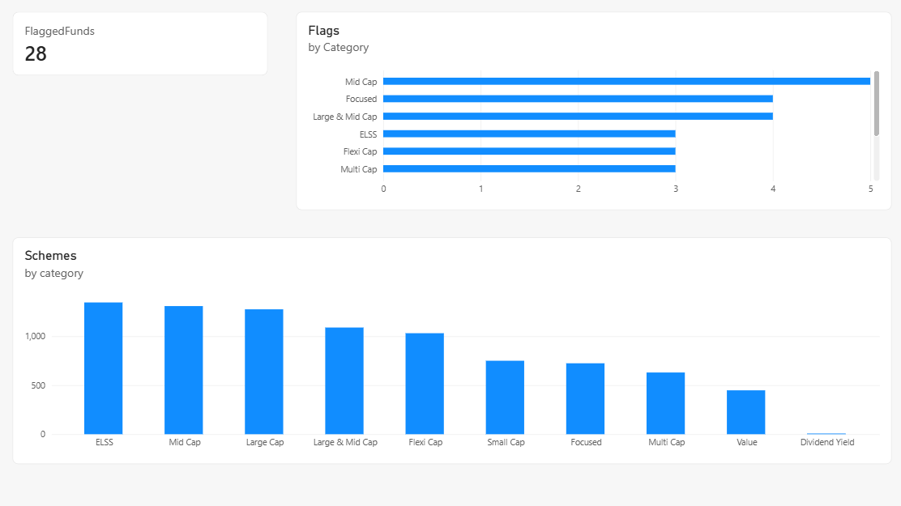
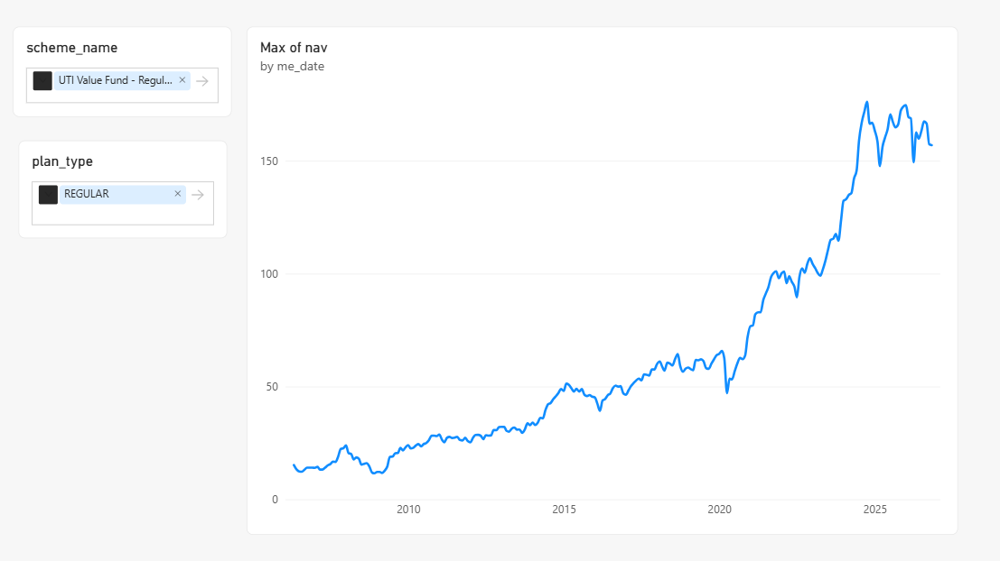
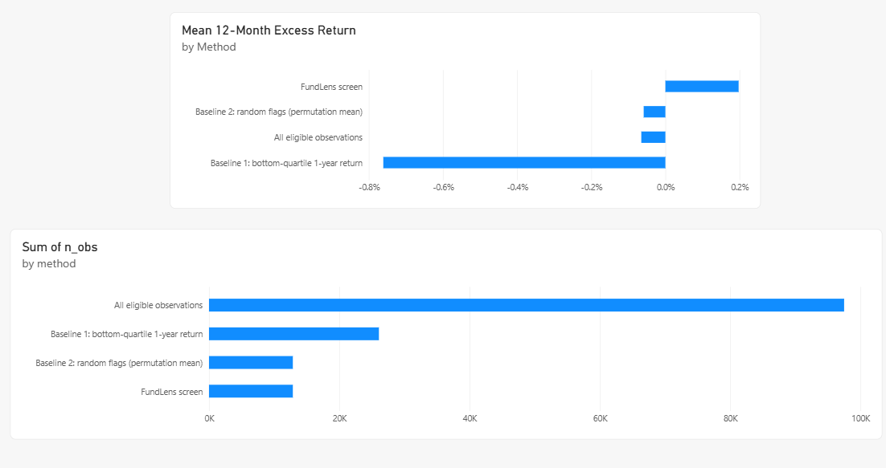
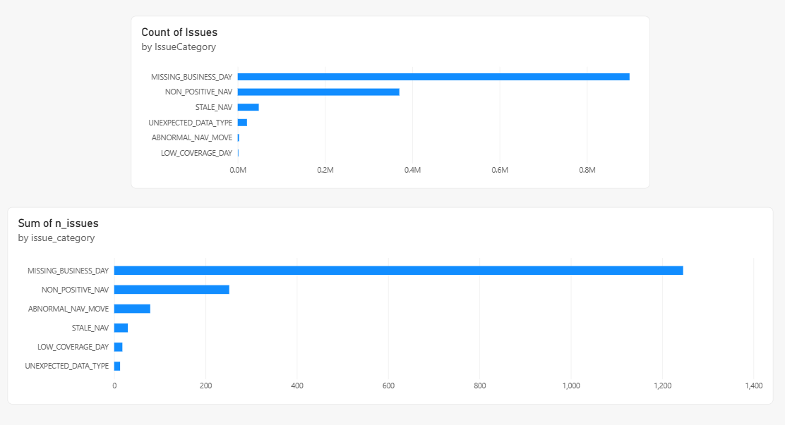

# FundLens
### Explainable Mutual Fund Research & Review Analytics

FundLens helps mutual fund research analysts identify schemes that may deserve further investigation.

It analyses historical Indian mutual fund Net Asset Values (NAVs), calculates performance and risk metrics, and identifies funds that meet configurable review criteria. Every flag is accompanied by the metrics and conditions that triggered it.

The goal is simple: turn historical mutual fund data into useful, explainable research insights.

**FundLens is a research-support tool, not an investment recommendation system.** A flagged fund is a fund worth investigating further. A flag does not mean buy, sell or hold.

---

## What does FundLens do?

FundLens takes mutual fund NAV data through a complete analytics pipeline.

| Stage | What happens |
|---|---|
| 1. Data collection | Retrieves historical NAV data from AMFI. |
| 2. Data storage | Loads and organises the data in PostgreSQL. |
| 3. Data validation | Checks for duplicates, missing observations, abnormal NAV movements and other data-quality issues. |
| 4. Financial analysis | Calculates returns, volatility, drawdowns and SIP XIRR. |
| 5. Fund screening | Identifies funds meeting the configured research-review criteria. |
| 6. Backtesting | Evaluates the screening methodology against historical outcomes and simpler baselines. |
| 7. Visualisation | Presents the results through an interactive Power BI dashboard. |

The pipeline is designed to be repeatable. Re-running ingestion should not create duplicate NAV observations, and analytical results can be regenerated from the available data.

## The fund review methodology

FundLens uses a rule-based screening approach to identify funds exhibiting persistent relative underperformance.

By default, a fund receives a research-review flag when both conditions are satisfied:

1. Its rolling three-year CAGR falls within the bottom 25% of its category.
2. Its three-year maximum drawdown is worse than the category median.

Both conditions must persist for three consecutive month-ends.

The persistence period and screening thresholds are configurable.

Each flag retains the underlying metric values and trigger conditions, allowing an analyst to understand why a scheme was selected.

**Important comparison rule:** Direct and Regular plans are treated as separate peer groups. Funds are compared against schemes belonging to the appropriate category and plan type.

## Evaluating the screening methodology

A screening rule is only useful if its results can be evaluated independently.

FundLens uses a historical walk-forward backtesting approach.

The evaluation:

- Uses historical information available at each evaluation month-end.
- Separates the timeline into approximately 60% training and 40% out-of-sample evaluation.
- Tunes screening parameters using the training period.
- Measures subsequent 12-month excess returns relative to the category median.
- Compares the proposed rule against two baselines:
  - Bottom-quartile one-year return screening.
  - Random flags generated at an equivalent flag rate.
- Reports 95% confidence intervals using a documented fund-clustered block-bootstrap approach.

The evaluation also documents limitations such as survivorship bias, overlapping return windows and category classification.

A positive backtest result is not proof of future predictive performance.

See `RESULTS.md` for the actual measured results and `docs/` for the methodology.

---

## Backtesting Results and Limitations

> **Measured, preserved outputs (pipeline run 2026-11-07; audited 2026-11-08).** This evaluation **does not validate** the intended "flag likely underperformers" hypothesis. *y* = fund's forward 12-month return ? category median forward 12-month return; **lower *y* among flagged funds = flags identified later underperformers**. See `RESULTS.md` and `results/backtest_*.json` (unchanged).

| Plan (out-of-sample) | Screen mean *y* | Fund-cluster 95% CI | Permutation p\* | Interpretation |
|---|---:|---:|---:|---|
| **DIRECT, default (primary)** | **+0.20%** (1,015 obs, 89 funds, 2022-07-29?2025-10-31) | [-0.99%, 1.60%] | 0.932 | **Inconclusive** (CI includes 0) |
| **DIRECT, tuned** | **+0.13%** (616 obs, 60 funds) | [-1.41%, 1.96%] | 0.835 | **Inconclusive** |
| **REGULAR, default** (sensitivity, longer history) | **+1.38%** (1,991 obs, 130 funds, 2019-10-31?2025-10-31) | [0.45%, 2.45%] | 1.000 | **Evidence in the opposite direction** (flagged outperformed; CI > 0) |
| **REGULAR, tuned** | **+0.53%** (1,859 obs, 122 funds) | [-0.29%, 1.43%] | 0.962 | **Inconclusive** |

\* **Permutation p-value (one-sided lower-tail on *y*):** `p = P(random-flag mean y <= observed)` (+ smoothing). **Small p** ? flagged did worse than random. **Large p (0.93, 1.00)** ? **not** worse than random (often better); **not** predictive validation. Regular/default shows the opposite of the screen's intent, not merely "no effect."

**Limitations (key):** survivorship bias (closed/merged funds largely missing; bias magnitude unknown), current AMFI category labels applied historically, overlapping 12-month windows / dependent observations (fund-cluster & month-block bootstraps help but don't remove dependence), short Direct out-of-sample window, 30-candidate training-only grid (some selection optimism), not investment advice / no clients/AUM / not production or GIPS-compliant. Full disclosure: `RESULTS.md`.

**Testing/evidence (reproducible):** 13 automated DQ rules (unresolved **CRITICAL** blocks analytics; 55 ERROR/1,331 WARNING open, 252 CRITICAL resolved in audited snapshot), **104 tests passed** in a fresh run (2026-11-08; unit, property-based/Hypothesis, integration), measured performance in `docs/PERFORMANCE.md`. Interview/resume framing: `docs/INTERVIEW_GUIDE.md`, `docs/RESUME_RECOMMENDATIONS.md`.

---

## Power BI Dashboard

FundLens includes an interactive, four-page Power BI dashboard
connected to PostgreSQL analytical marts. It provides an overview
of flagged mutual funds, scheme-level performance, data quality,
and the out-of-sample evaluation of the screening methodology.

### 1. Fund Review

Provides an overview of flagged mutual funds and their distribution
across mutual fund categories. Users can explore flagged schemes
and identify categories with a higher concentration of review flags.



### 2. Fund Drilldown

Allows users to select an individual mutual fund scheme and plan
type (Direct or Regular) to inspect its historical NAV movement.
The page supports scheme-level analysis without aggregating NAV
values across unrelated funds.



### 3. Backtesting

Evaluates the FundLens screening methodology using out-of-sample
data and compares its results against baseline approaches.

The evaluation includes performance comparisons, observation
counts, and statistical uncertainty. Results are interpreted
with the limitations of the dataset and methodology in mind.

The screening rule is not presented as a proven investment strategy.



### 4. Data Quality

Provides visibility into data-quality issues identified during
the ingestion and validation process. Issues are grouped by
category to help monitor the reliability of the underlying
mutual fund NAV data.



> **Disclaimer:** FundLens generates research-review flags for
> analytical purposes only. These flags are not investment
> recommendations or instructions to buy, hold, or sell mutual funds.

### Opening the dashboard

Open:

`dashboard/FundLens/FundLens.pbip`

in Power BI Desktop.

The report connects to your local PostgreSQL database. Configure the connection using the values in your local `.env` file and refresh the report.

The `.pbip` project contains the report and semantic-model definitions used for development and version control.

A `.pbix` file can be saved locally from Power BI Desktop using **File → Save As**. Because an imported PBIX may contain a snapshot of the underlying financial data, the local PBIX is intentionally kept outside the public source repository.

See `dashboard/README.md` for dashboard-specific instructions.

---

## Data source and usage

FundLens uses genuine historical NAV data from the Association of Mutual Funds in India (AMFI).

**Source:** https://www.amfiindia.com/

The project uses AMFI data rather than fabricated NAV observations for its financial analysis.

AMFI data is not included in this repository. The original downloads and processed datasets must be obtained locally through the ingestion pipeline.

Data files are excluded from Git because their use and redistribution are subject to source-specific restrictions.

Before using or redistributing downloaded data, consult the applicable AMFI terms.

For information about the source, retrieval process, data fields and known limitations, see:

- `docs/DATA_CARD.md`
- `docs/DECISIONS.md`

---

## Technology stack

| Component | Technology | Purpose |
|---|---|---|
| Data source | AMFI | Historical mutual fund NAVs |
| Data processing | Python, Pandas, NumPy | Ingestion and processing |
| Database | PostgreSQL 16 | Storage and analytical queries |
| Query layer | SQL | Financial metrics, ranking and reporting marts |
| Data quality | Python, SQL | Validation and issue detection |
| Testing | Pytest, Hypothesis | Calculation and pipeline validation |
| Dashboard | Microsoft Power BI | Interactive analytics |
| Automation | GitHub Actions | CI and scheduled workflows |
| Development | Git, Docker, VS Code | Version control and local environment |

---

## Getting started

FundLens runs locally using PostgreSQL in Docker and a Python virtual environment.

### Prerequisites

Install the following:

- Windows 10/11 or a compatible development environment.
- Docker Desktop.
- Git.
- Python version supported by `pyproject.toml`.
- PowerShell for the Windows commands below.
- Power BI Desktop to open the dashboard.

### 1. Clone the repository

```powershell
git clone https://github.com/Vicky231006/FundLens.git
cd FundLens
```

### 2. Create the Python environment

```powershell
python -m venv .venv
```

Activate it:

```powershell
.\.venv\Scripts\Activate.ps1
```

Install the project and development dependencies:

```powershell
python -m pip install --upgrade pip
python -m pip install -e ".[dev]"
```

### 3. Configure the database

Create your local environment file:

```powershell
Copy-Item .env.example .env
```

Open `.env` and configure the PostgreSQL credentials.

Make sure the database password used by Docker and the password in `DATABASE_URL` match.

Start PostgreSQL:

```powershell
docker compose up -d db
```

Check the container:

```powershell
docker compose ps
```

Wait until PostgreSQL reports a healthy status.

### 4. Create the database schema

```powershell
.\make.ps1 migrate
```

This applies the versioned SQL migrations and creates the required database objects.

### 5. Download and ingest historical NAV data

```powershell
.\make.ps1 ingest
```

This retrieves the configured AMFI data, preserves source files and loads the observations into PostgreSQL.

The initial download can take approximately 1ΓÇô2 hours and may require around 2.5 GB of local storage, depending on the configured historical scope.

### 6. Run the analytics pipeline

```powershell
.\make.ps1 pipeline
```

The pipeline executes data-quality checks, builds analytical outputs, applies the review-screening rules, runs the backtest and generates `RESULTS.md`.

### 7. Run the test suite

```powershell
.\make.ps1 test
```

This runs the project's automated unit, property-based and database integration tests.

### Linux and macOS

The repository also provides a Makefile:

```bash
make setup
make db-up
make migrate
make ingest
make pipeline
make test
```

For the complete reproduction workflow:

```bash
make reproduce
```

The equivalent Windows workflow is:

```powershell
.\make.ps1 reproduce
```

The reproduction target runs the documented migration, ingestion and analytical pipeline steps. It may take considerable time when historical data needs to be downloaded.

---

## Useful commands

Once the environment is configured, the FundLens CLI provides the following operations:

| Command | Description |
|---|---|
| `fundlens migrate` | Apply database migrations. |
| `fundlens ingest` | Download and load NAV data. |
| `fundlens verify-raw` | Verify preserved source files against the raw-data registry. |
| `fundlens dq` | Run data-quality checks. |
| `fundlens build-marts` | Build analytical SQL functions and materialised views. |
| `fundlens pipeline` | Execute the complete analytics pipeline. |
| `make reproduce` | Re-run the documented workflow and regenerate results. |

The ingestion command also supports date ranges and optional refetching:

```powershell
fundlens ingest --from YYYY-MM-DD --to YYYY-MM-DD
```

Use `--force-refetch` when a source-data refetch is specifically required.

The pipeline exits with an error when unresolved critical data-quality issues prevent further processing.

---

## Project structure

The repository is organised into separate components for ingestion, database engineering, analytics, testing and reporting.

```text
FundLens/
Γöé
Γö£ΓöÇΓöÇ config/
Γöé   ΓööΓöÇΓöÇ Application settings and screening configuration
Γöé
Γö£ΓöÇΓöÇ src/
Γöé   ΓööΓöÇΓöÇ fundlens/
Γöé       Γö£ΓöÇΓöÇ ingestion/       AMFI data retrieval and loading
Γöé       Γö£ΓöÇΓöÇ validation/      Data-quality checks
Γöé       Γö£ΓöÇΓöÇ metrics/         Financial calculations
Γöé       Γö£ΓöÇΓöÇ screening/       Review-flag generation
Γöé       ΓööΓöÇΓöÇ backtesting/     Historical evaluation
Γöé
Γö£ΓöÇΓöÇ sql/
Γöé   Γö£ΓöÇΓöÇ migrations/          Database schema changes
Γöé   Γö£ΓöÇΓöÇ marts/               Analytical functions and views
Γöé   ΓööΓöÇΓöÇ adhoc/               Analyst SQL queries
Γöé
Γö£ΓöÇΓöÇ tests/
Γöé   Γö£ΓöÇΓöÇ unit/
Γöé   Γö£ΓöÇΓöÇ property/
Γöé   ΓööΓöÇΓöÇ integration/
Γöé
Γö£ΓöÇΓöÇ dashboard/
Γöé   ΓööΓöÇΓöÇ FundLens/            Power BI project
Γöé
Γö£ΓöÇΓöÇ docs/
Γöé   Γö£ΓöÇΓöÇ BRD.md
Γöé   Γö£ΓöÇΓöÇ USER_STORIES.md
Γöé   Γö£ΓöÇΓöÇ ARCHITECTURE.md
Γöé   Γö£ΓöÇΓöÇ DECISIONS.md
Γöé   ΓööΓöÇΓöÇ DATA_CARD.md
Γöé
Γö£ΓöÇΓöÇ RESULTS.md
Γö£ΓöÇΓöÇ DEVELOPMENT_LOG.md
Γö£ΓöÇΓöÇ TODO.md
Γö£ΓöÇΓöÇ docker-compose.yml
ΓööΓöÇΓöÇ README.md
```

## Reproducibility and limitations

FundLens is an independent portfolio project developed to demonstrate financial analytics and data engineering.

A few limitations should be kept in mind:

- Historical scheme availability can affect the completeness of comparisons.
- Closed and merged scheme histories may be unavailable or incomplete.
- Historical category classifications may not perfectly represent past peer groups.
- Overlapping forward-return windows introduce statistical dependence.
- Backtested findings should not be interpreted as guaranteed future performance.

All reported performance figures should be traceable to a reproducible run and documented evaluation period.

Use `RESULTS.md` for measured outcomes, including the relevant dataset size, comparison baseline and evaluation period.

**FundLens does not manage real client portfolios, hold customer accounts or manage assets under management. It is not a production investment service and does not claim GIPS compliance.**

---

## Documentation

For a deeper understanding of the project:

| Document | Contents |
|---|---|
| `docs/BRD.md` | Business problem and requirements |
| `docs/USER_STORIES.md` | Stakeholder needs and acceptance criteria |
| `docs/ARCHITECTURE.md` | System components and data flow |
| `docs/DECISIONS.md` | Technical decisions and rationale |
| `docs/DATA_CARD.md` | Data sources, fields and limitations |
| `RESULTS.md` | Reproducible evaluation results |
| `docs/PERFORMANCE.md` | Performance measurements |

---

**FundLens ΓÇö Making mutual fund research more systematic, explainable and reproducible.**
