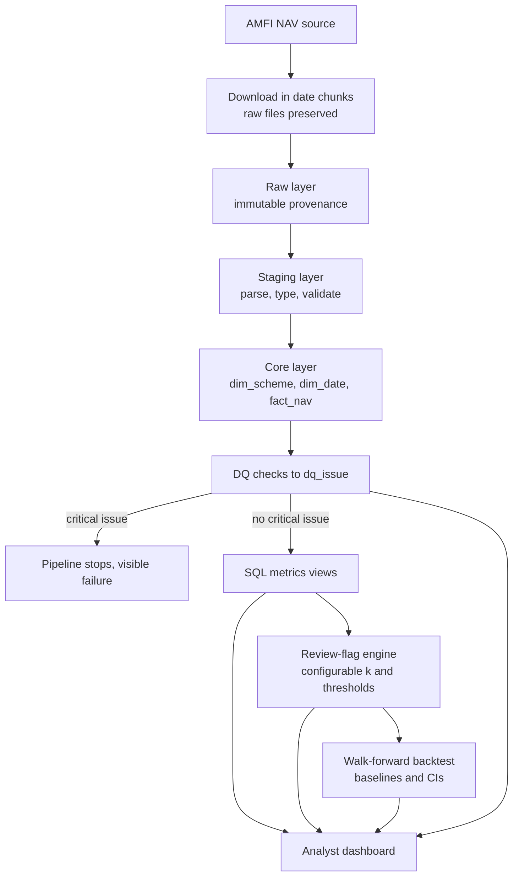

# FundLens - Business Requirements Document (BRD)

| Item | Value |
|---|---|
| Project | FundLens - Explainable Mutual Fund Review-Flag Analytics Engine |
| Document status | Draft v0.1 (Phase 0) |
| Source specification | `PROMPT.md` (sections 1-3, 8, 9, 13, 14) |
| Nature of the tool | Analyst-support / research-review tool. **Not** an investment recommendation engine. |

> **Positioning statement.** FundLens flags mutual funds for *further research review*. A flag
> is not advice and never means "buy", "sell" or "switch". FundLens is a portfolio / learning
> project built on public data. It is not described as production-grade or GIPS-compliant, and
> this document makes no claim about real clients, assets under management or users.

---

## 1. Business problem

Research analysts who support wealth-management advisors must regularly decide which mutual
funds deserve a closer look. The signals they care about are *persistent relative
underperformance* (a fund lagging its category peers over several years) combined with
*elevated drawdown* (it also falls harder than peers in bad markets).

Doing this consistently is difficult because:

- **Inconsistent criteria.** Different analysts may use different look-back windows, peer
  groups and cut-offs, so the same fund can be treated differently depending on who reviews it.
- **Poor explainability.** A fund can be put on a watch list without a recorded reason, so the
  decision cannot later be explained to a desk lead or advisor.
- **Weak reproducibility.** Spreadsheet results depend on when the data was pasted in and which
  formulas were last edited; they are hard to re-run exactly.
- **Unmanaged data quality.** Mutual-fund NAV histories contain gaps, stale values, renamed or
  merged schemes and suspicious jumps. If these are not surfaced, screening results can be
  silently wrong.
- **Unevaluated methodology.** A screening rule is rarely tested on history. Without a
  walk-forward evaluation against simple baselines, nobody knows whether the rule adds anything
  beyond a trivial one-year-return screen.

FundLens addresses these gaps with a reproducible pipeline: ingest genuine NAV data, check its
quality, compute metrics in SQL, apply a configurable and explainable flag rule, evaluate that
rule honestly on history, and present the results in a dashboard.

## 2. Business objectives

| ID | Objective | How it is judged |
|---|---|---|
| BO-1 | Provide a single, consistent definition of a "review flag" that every analyst applies in the same way. | The rule and its parameters live in version-controlled configuration; the same data and config always produce the same flags. |
| BO-2 | Make every flag explainable. | Each flag records which conditions fired (3-year return quartile, drawdown vs. category median, persistence count k). |
| BO-3 | Make data issues visible rather than hidden. | All detected issues are persisted in `dq_issue` with severity and status; critical issues stop the analytics pipeline. |
| BO-4 | Evaluate the screening method honestly. | Walk-forward, out-of-sample results are reported against two baselines with 95% confidence intervals, and negative or inconclusive results are reported as such. |
| BO-5 | Reduce manual refresh effort. | A scheduled monthly refresh runs ingest, validate, load, DQ checks, analytics refresh and a refresh report, and fails visibly on critical problems. |
| BO-6 | Keep claims auditable. | Every reported metric states its measured value, baseline, dataset size and evaluation period, and is reproducible with `make reproduce`. |

## 3. Stakeholders

| Stakeholder | Interest | Main FundLens touchpoints |
|---|---|---|
| **Research analyst** | Identify funds that deserve deeper review, understand why each was flagged, and export lists for write-ups. | Fund review screen, fund drilldown, category comparison, CSV export, ad-hoc SQL. |
| **Desk lead** | Oversee consistency and rigour of the review process; understand how trustworthy the method is; tune its sensitivity. | Backtesting page, configuration of k and thresholds, refresh status, disclosures. |
| **Data operations** | Keep the data complete, correct and fresh; triage and resolve data issues; confirm scheduled refreshes work. | Data-quality page, `dq_issue` workflow, scheme-mapping review, monthly refresh report and workflow status. |
| **Developer / maintainer** | Build and maintain the system; keep it reproducible, tested and documented. | Repository, migrations, test suites, CI, `DECISIONS.md`, backlog. |

Note: these are *roles* used to frame requirements. FundLens makes no claim of having real
users in these roles.

## 4. Current process (assumed / illustrative baseline)

> The description below is an **assumed, illustrative baseline** used to motivate the
> requirements. It is not a description of any real firm's process and no measurement of it
> has been made.

A typical manual fund-screening workflow might look like this:

1. An analyst downloads NAV files or fund-factsheet data from a public site and pastes them
   into a spreadsheet.
2. Returns and drawdowns are computed with spreadsheet formulas. Look-back windows, category
   assignments and cut-offs are chosen by the individual analyst.
3. Obvious data problems (gaps, odd jumps, renamed schemes) are caught by eye, if at all, and
   are not logged.
4. Candidate funds are listed in a worksheet or email with a short free-text rationale.
5. Nobody back-tests the rule, so there is no evidence of how it would have performed against
   a trivial baseline, and no allowance for survivorship or look-ahead bias.
6. Refreshing the analysis next month means repeating the manual steps.

Resulting weaknesses: inconsistency between analysts, lack of audit trail, no data-quality
record, no evidence on method value, and effort repeated each cycle.

## 5. Proposed process

1. **Ingest** NAV data from AMFI in date chunks; keep every original file and log run metadata.
2. **Standardise** schemes into a dimension, with explicit rename/merge mappings reviewed by a
   human. Similar names alone never cause a merge.
3. **Check quality** with automated checks; persist all issues; never auto-delete questionable
   observations; stop the pipeline on critical issues.
4. **Compute metrics** in SQL (rolling CAGR, volatility, maximum drawdown, SIP XIRR, category
   percentile rank) with documented conventions and explicit handling of insufficient history.
5. **Flag** funds for review with a configurable, explainable rule, using only information
   available at each month-end.
6. **Evaluate** the rule with walk-forward backtesting against baselines, with block-bootstrap
   confidence intervals and documented limitations.
7. **Present** results in a dashboard that always shows the last successful refresh date and a
   data-limitations disclosure.
8. **Automate** the monthly refresh via GitHub Actions and produce a refresh report.

## 6. Functional requirements

Requirement IDs and content follow `PROMPT.md` section 8 (FR-A1 to FR-A9). The preserved
scope is not changed here; each row restates it with a one-line description and an
acceptance condition.

| ID | Title | Description | Acceptance condition |
|---|---|---|---|
| FR-A1 | Idempotent ingestion | A Python pipeline retrieves genuine AMFI NAV data, parses and validates it, loads it into PostgreSQL without duplicates, preserves original source files and logs ingestion metadata. | Running ingestion twice on the same date range leaves `fact_nav` row counts unchanged; every loaded row traces to a stored source file and an ingestion-run record; original files are retained unmodified. |
| FR-A2 | Scheme standardisation | A standardised scheme dimension plus a mapping mechanism for scheme renames and mergers; schemes are never merged on name similarity alone. | Each scheme has one `dim_scheme` identity covering AMC, category, name, Direct/Regular and Growth/IDCW; rename/merge links exist only as explicit `scheme_mapping` rows; a test shows two similarly named but distinct schemes remain separate. |
| FR-A3 | Data quality framework | Checks for missing business-day observations, abnormal day-over-day NAV moves, non-positive NAV, duplicate scheme-date pairs, stale NAV, missing/invalid scheme identifiers, invalid dates and unexpected data types; issues persisted in `dq_issue`; critical issues stop the pipeline; questionable data is never auto-deleted. | Each check has a test with injected faults that produces the expected `dq_issue` rows (issue id, scheme id where applicable, category, detection timestamp, severity, observation, explanation, resolution status); a critical issue causes a non-zero pipeline exit before analytics run; no `fact_nav` rows are deleted by DQ code. |
| FR-A4 | Financial metrics | SQL views (or justified materialised views) for rolling 1/3/5-year CAGR, annualised volatility, maximum drawdown, standardised SIP XIRR and month-end category percentile rank, with documented date and annualisation conventions. | Every formula matches a hand-computed example; invariants hold (constant NAV gives zero volatility, maximum drawdown is never positive, scaling NAVs does not change returns); insufficient history returns an explicit null/flag rather than a value from incomplete data. |
| FR-A5 | Configurable review-flag algorithm | Default rule: at month-end t a fund is flagged when its 3-year rolling return is in the bottom quartile of its category, its drawdown is worse than the category median, and both persist for k consecutive month-ends; k and thresholds configurable; tuned on the training period only; no future information; each flag carries an explanation. | Changing k or a threshold in config changes the flag output accordingly; a test confirms flags at month-end t do not change when data after t is altered; every flag row records which conditions fired; output is labelled a research-review flag. |
| FR-A6 | Walk-forward backtesting | At each month-end use only data up to that date, compute metrics, apply the rule, generate flags and evaluate subsequent 12-month returns, where y = fund forward 12-month return minus category median forward 12-month return; compare against Baseline 1 (bottom-quartile 1-year return) and Baseline 2 (random flags at the same rate, permutation-based); about 60% of the timeline for tuning and the rest out-of-sample; fund-clustered block bootstrap with 95% CIs; document survivorship bias. | A correctness test shows no look-ahead (results unchanged when post-t data is perturbed); results report measured value, baseline, dataset size, evaluation period and 95% CI; overlapping-window and dependence handling is documented; limitations (survivorship, missing closed/merged schemes) are stated; no predictive-ability claim is made without supporting evidence. |
| FR-A7 | Analyst dashboard | Interactive dashboard with (A) fund review screen, (B) fund drilldown, (C) data-quality page, (D) backtesting page; every page shows the last successful refresh date and a data-limitations disclosure. | Each of the four sections exists and shows the content listed in `PROMPT.md` FR-A7; dashboard figures for sampled funds match the underlying SQL output; CSV export reproduces the filtered table; last refresh date and disclosure appear on every page. |
| FR-A8 | Monthly automation | A scheduled GitHub Actions workflow retrieves the latest NAV, validates, loads, runs DQ checks, refreshes analytical outputs, generates a refresh report and fails visibly when critical checks fail; no secrets in the repo; remote database hosting strategy documented. | The workflow runs on a monthly schedule and on manual dispatch; a simulated critical DQ failure turns the run red; a refresh report artefact is produced; credentials come only from repository secrets; hosting strategy is written in `ARCHITECTURE.md`. |
| FR-A9 | Ad-hoc SQL | At least ten SQL files under `sql/adhoc/`, each starting with the business question it answers, demonstrating CTEs, window functions, aggregations, joins, ranking, time-series analysis, DQ investigation and performance comparison. | At least ten files exist; each begins with a business-question comment; each runs without error against the actual schema (verified by a test or script); the listed techniques are each used by at least one file. |

## 7. Non-functional requirements

| ID | Category | Requirement |
|---|---|---|
| NFR-1 | Reproducibility | The same raw files, configuration and code must produce the same database state and results. Randomised steps (permutation baseline, bootstrap) use recorded seeds. Every reported metric is reproducible with one command: `make reproduce`. Dependencies and Python version are pinned via `pyproject.toml`. |
| NFR-2 | Explainability | Every flag carries a machine- and human-readable reason (which conditions fired and with what values). Every metric has a documented formula, date convention and annualisation assumption. |
| NFR-3 | Auditability / immutable raw layer | Original source files are preserved on disk; raw tables store provenance (source URL, retrieval time, file hash, ingestion run). The normal ingestion workflow only inserts into the raw layer and never updates or deletes. Conflicting revisions of an observation are recorded (`nav_revision_conflict`), not overwritten silently. DQ code never deletes observations. |
| NFR-4 | Performance (measured, not invented) | Ingestion time, row counts, query latency, dashboard query latency, index effects and materialised-view refresh time are measured and documented *with the dataset size used*. No performance figure is quoted unless it has been measured and can be re-run. Targets are set only after a first baseline measurement exists. |
| NFR-5 | Security | No secrets, passwords or tokens in the repository; configuration via environment variables with a committed `.env.example` containing placeholders only; CI uses repository secrets; database users for the dashboard should be read-only where practical. |
| NFR-6 | Data licensing | AMFI data is public but public accessibility does not imply unrestricted redistribution. Terms of use are reviewed and recorded in `DATA_CARD.md`; raw data files are not committed to a public repository unless the terms allow it; only derived/aggregated outputs are published if redistribution is unclear. |
| NFR-7 | Testing and quality | Unit, database-integration, financial-calculation, data-quality, property-based, idempotency and backtesting-correctness tests; linting with `ruff`; a feature is not "done" merely because its code runs. |
| NFR-8 | Honesty | Synthetic data, if used, is clearly labelled and results on injected faults are described as such. Negative and inconclusive results are reported. No claim of real clients, AUM or users. |

## 8. Assumptions

1. AMFI's historical NAV endpoint remains available and keeps its current format. (Verified in
   this project on 2026-11-07: history starts 2006-04-01 and a single request may span at most
   about 90-105 days, so ingestion is date-chunked at 90 days.)
2. Scope is open-ended equity schemes in the equity categories defined in
   `config/scope.toml`; both Direct and Regular plans are ingested, analytics are computed
   within a plan type and default to Direct; only Growth options are in scope.
3. NAV is treated as a total-return proxy for Growth options (no dividend reinvestment
   adjustment needed). IDCW options are out of scope.
4. Month-end observations use the last available NAV on or before the calendar month-end.
5. Category assignment is taken from AMFI section headers and is not re-derived from scheme
   names.
6. PostgreSQL 16 (Docker Compose locally) is the single analytical store.
7. A hosted PostgreSQL instance (to be selected) will be needed for scheduled remote runs in
   GitHub Actions.
8. The initial deployment is single-developer; there is no multi-user authentication
   requirement for the dashboard in the first release.

## 9. Constraints

- **Data availability:** only what AMFI's public endpoint returns; no history before 2006-04-01;
  limited range per request.
- **Survivorship:** schemes that were closed or merged and are not present in the current
  AMFI listing may be missing (see risks).
- **No fabricated data:** no synthetic NAVs may substitute for market data.
- **Technology:** Python 3.14, PostgreSQL 16, Docker Compose, GitHub Actions, `ruff` and
  `pytest`; no technology added merely to appear sophisticated.
- **Time:** delivery is organised in one-week sprints (see `docs/JIRA_BACKLOG.md`); the plan is
  an estimate and not a commitment.
- **Cost:** free or low-cost tiers for any hosted database or dashboard hosting.
- **Regulatory framing:** outputs must be framed as research-review flags and must not be
  presented as investment advice.

## 10. Risks

| ID | Risk | Likelihood | Impact | Mitigation |
|---|---|---|---|---|
| R-1 | **AMFI terms of use** restrict storage, redistribution or automated scraping in ways not yet fully understood. | Medium | High | Read and record the terms in `DATA_CARD.md` before publishing anything; do not commit raw files to a public repo unless permitted; throttle requests and identify the client; publish derived aggregates only if unclear; seek alternative legitimate sources if needed and document the change in `DECISIONS.md`. |
| R-2 | **Survivorship bias:** closed/merged schemes missing or excluded (legacy headers are excluded in `scope.toml`) make historical peer groups look better than reality. | High | High | Document explicitly; show the limitation on the backtesting page; never claim results demonstrate predictive ability without evidence; where possible report how many schemes appear/disappear over time. |
| R-3 | **Look-ahead bias:** metrics, category ranks, parameter tuning or the category median use data after the evaluation month-end. | Medium | High | Compute everything as-of month-end; tune on the first ~60% only; add backtesting-correctness tests that perturb post-t data and require unchanged flags; review SQL window frames. |
| R-4 | **Data gaps:** missing NAV days, stale NAVs, short histories for new funds distort rolling metrics. | High | Medium | DQ checks persist gaps; metrics return explicit "insufficient history" instead of a value; minimum-observation rules documented. |
| R-5 | **AMFI endpoint changes** (URL, format, date limits, rate limiting) break ingestion. | Medium | High | Parser unit tests with saved samples; ingestion fails loudly on unrecognised format; preserve raw files so earlier loads remain reproducible; schedule workflow failure alerts; document the endpoint verification date. |
| R-6 | **Scheme renames/mergers** are mis-linked, producing false continuity or breaks. | Medium | High | Mappings are explicit and human-reviewed; no name-similarity auto-merge; mapping review workflow with status. |
| R-7 | **Overfitting** the flag parameters to history. | Medium | Medium | Train/test split by time; out-of-sample evaluation only for reported results; report inconclusive results honestly. |
| R-8 | **Overlapping 12-month windows** inflate apparent significance. | High | Medium | Fund-clustered block bootstrap; document assumptions; conservative interpretation of CIs. |
| R-9 | **Remote database hosting** for scheduled runs is unavailable or costly. | Medium | Medium | Document the hosting strategy; evaluate free-tier hosted PostgreSQL; keep local reproducibility as the fallback. |
| R-10 | **Misinterpretation as advice:** users may treat a flag as a sell signal. | Medium | High | Mandatory disclosure on every dashboard page and in exports; wording "flagged for research review" only. |
| R-11 | **Secrets leak** via committed config or CI logs. | Low | High | `.env` git-ignored; `.env.example` only placeholders; CI secrets; secret scanning before publishing. |

## 11. Success criteria

FundLens is considered successful for this project when all of the following are demonstrably
true. None of these is claimed as achieved yet.

1. FR-A1 to FR-A9 are implemented, each with passing acceptance tests (traceability matrix
   status = "Done").
2. Re-running ingestion produces no duplicate NAV records, verified by an integration test.
3. All eight DQ check types detect their injected faults, and a critical failure stops the
   pipeline.
4. Financial metrics agree with hand-computed examples and independent reference
   implementations, and invariants pass under property-based testing.
5. Every flag displays its triggering conditions.
6. The backtest reports out-of-sample results against both baselines with 95% confidence
   intervals, dataset size and evaluation period, plus documented limitations; the reported
   outcome is stated honestly even if it is negative or inconclusive.
7. The dashboard's four sections work and show last refresh date and disclosure.
8. The monthly workflow runs on GitHub Actions and fails visibly on critical DQ issues.
9. `make reproduce` regenerates every figure reported in `RESULTS.md`.
10. At least ten ad-hoc SQL files run against the real schema.
11. No document claims real clients, AUM or users, production-grade quality, or GIPS compliance.

## 12. Requirements traceability matrix (RTM)

Locations are *planned*. A path in this table does not mean the file exists yet.

Status legend: **Planned** = nothing deliverable yet; **In progress** = partially implemented;
**Done** = implemented and acceptance condition verified (no row is Done at this time).

| FR | Planned code module | Planned SQL | Planned tests | Planned doc / other | Status |
|---|---|---|---|---|---|
| FR-A1 Idempotent ingestion | `src/fundlens/ingestion` (downloader, parser, loader) | `sql/migrations` (raw, staging, core layers, `dim_date`) | `tests/unit` (parser, downloader); `tests/integration` (idempotent load, still to be written) | `docs/DATA_CARD.md`, `docs/ARCHITECTURE.md` | In progress |
| FR-A2 Scheme standardisation | `src/fundlens/ingestion` (scheme identity and mapping logic) | `sql/migrations` (`dim_scheme`, `scheme_mapping`, `scheme_name_history` tables) | `tests/unit` (identity rules); `tests/integration` (no merge on similar names) | `docs/ARCHITECTURE.md`, `docs/DECISIONS.md` | Planned |
| FR-A3 Data quality framework | `src/fundlens/validation` | `sql/migrations` (`dq_issue`) ; `sql/adhoc` (DQ investigation) | `tests/unit` (each check); `tests/integration` (pipeline blocks on critical); `tests/property` | `docs/DATA_CARD.md` | Planned |
| FR-A4 Financial metrics | `src/fundlens/metrics` (reference implementations) | `sql/marts` (CAGR, volatility, drawdown, XIRR, percentile rank views) | `tests/unit` (hand-computed); `tests/property` (invariants) | `docs/ARCHITECTURE.md` (conventions) | Planned |
| FR-A5 Review-flag algorithm | `src/fundlens/screening` | `sql/marts` (flag inputs and output) | `tests/unit` (rule logic); `tests/integration` (as-of correctness) | `config/` (parameters); `docs/DECISIONS.md` | Planned |
| FR-A6 Walk-forward backtesting | `src/fundlens/backtesting` | `sql/marts` (forward-return views) | `tests/unit`; `tests/integration` (no look-ahead); `tests/property` | `RESULTS.md`; `results/` | Planned |
| FR-A7 Analyst dashboard | `dashboard/` | `sql/marts` (dashboard-facing views) | `tests/integration` (dashboard figures match SQL) | `README.md` | Planned |
| FR-A8 Monthly automation | `src/fundlens/ingestion`, `src/fundlens/validation` (CLI entry points) | n/a | `tests/integration` (refresh run, failure path) | `.github/workflows/monthly_refresh.yml`; `docs/ARCHITECTURE.md` (hosting) | Planned |
| FR-A9 Ad-hoc SQL | n/a | `sql/adhoc` (10+ files) | `tests/integration` (every file executes) | `README.md` (index of queries) | Planned |

### RTM status note (honest state as of this draft)

- **FR-A1 is partially implemented.** Written so far: the AMFI download and parse code, an
  idempotent loader, unit tests for the parser and downloader, and migrations 001-004 (raw,
  staging and core layers plus the seeded `dim_date`), applied to a local PostgreSQL 16
  database. Not yet done: a database integration test proving idempotency, a full historical
  load, and final DATA_CARD content. It is therefore **In progress**, not Done.
- Migration 003 already created the `dim_scheme`, `scheme_mapping`, `scheme_name_history` and
  `dq_issue` tables. That is table structure only; the logic that populates and uses them is
  not written, so FR-A2 and FR-A3 remain **Planned**.
- All other requirements are **Planned**.

## 13. Open items

- Confirm AMFI terms of use and record the conclusion in `DATA_CARD.md`.
- Choose the remote PostgreSQL hosting option for FR-A8.
- Choose the dashboard framework (record in `DECISIONS.md`).
- Define numeric DQ thresholds (abnormal-move cut-off, stale-NAV days) and record the rationale.
